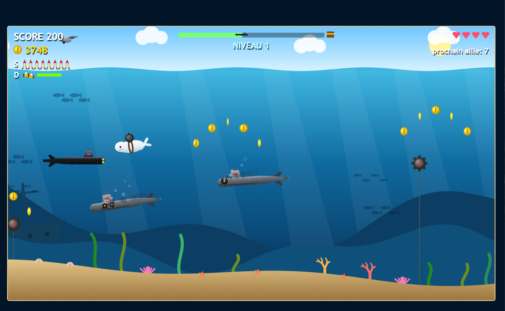
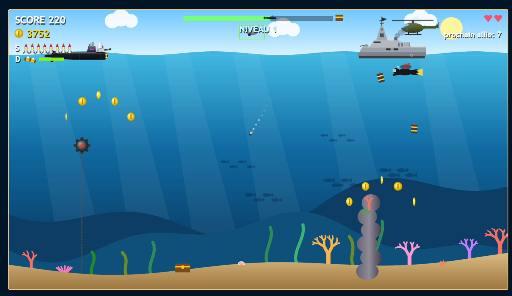

# Bataille sous la mer

A kids' underwater side-scroller. Drive a French attack sub and fight mines, octopuses, electric eels,
enemy subs, frigates, helicopters, drones and kamikaze belugas.

It is a single file, `index.html`, with no install, no build and no assets: every graphic is drawn on a
canvas and every sound is synthesized live.

## Play

Open `index.html` in a browser (on macOS: `open index.html`). It works offline, with no server.

| Key | Action |
|---|---|
| ← ↑ → ↓ | Swim (the sub is heavy and keeps its momentum) |
| SPACE | Torpedo, or the anti-aircraft gun (CIWS) when surfaced |
| F (hold) | Short-range laser |
| D | Decoys, to lure torpedoes, mines and belugas |
| S | H-bomb (8 per level); opens the shop on the title screen |
| ENTER | Start / play again |

Action keys work by position, so they are the same on AZERTY and QWERTY keyboards.

Tips:
- Hold ↑ to surface: a Phalanx gun comes out of the deck and shoots down helicopters and drones.
- The electric eel (from level 2) doesn't take a life, but it jams your weapons for 10 s.
- Every 10 kills gives you an ally sub (up to 2), then extra lives.
- Coins buy new subs in the shop (S on the title screen).

## Contribute with Claude

This game is built by asking [Claude Code](https://claude.com/claude-code) for changes in plain words.

1. Open a terminal in this folder and run `claude`.
2. Ask for what you want, in French or English, for example:
   - "Add a shark enemy from level 3"
   - "Make the torpedoes faster"
   - "The helicopter sound is too quiet"
3. Claude edits `index.html`, tests the change in a browser and reopens the game for you.
4. Play it and say what to change. Tuning by feel is the normal way to work here.

`AGENTS.md` holds the project rules Claude follows: the code layout, the conventions and the gameplay
rules already agreed. Keep it up to date when the game changes; Claude does this for you.

Ground rules:
- Keep everything in `index.html`: no libraries, images or extra files.
- In-game text stays in French, without accents. Code and comments are in English.
- There is no git history, so back up `index.html` before a big change.
